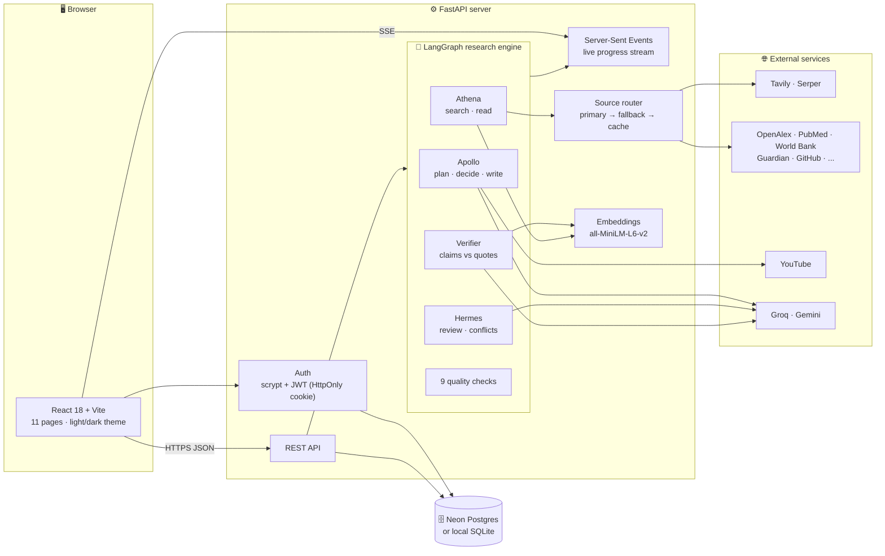
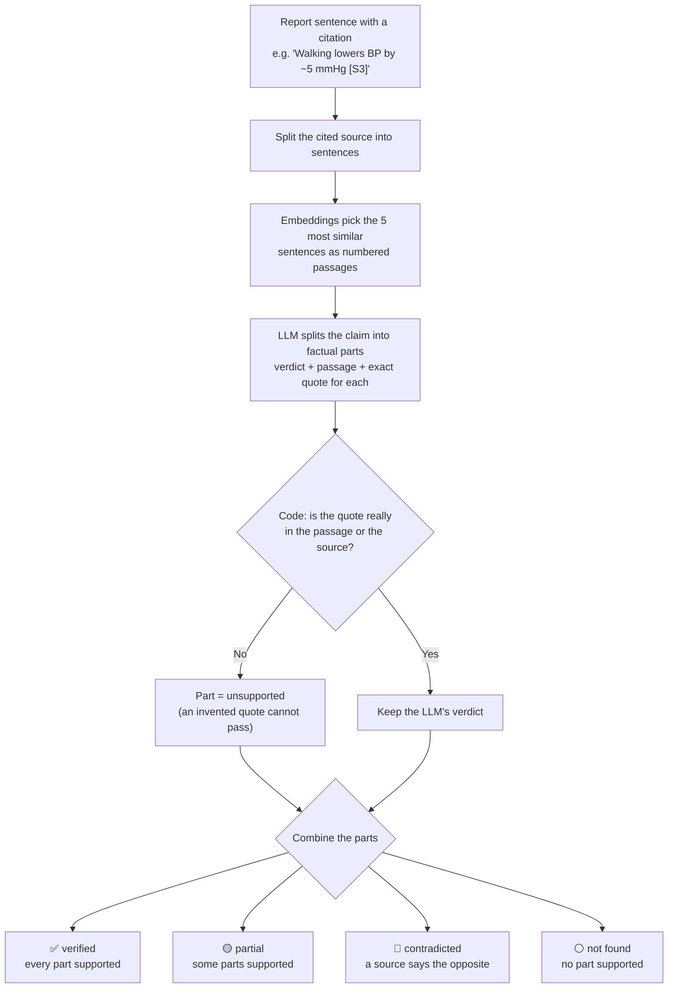
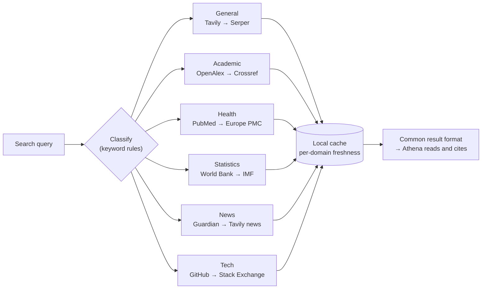
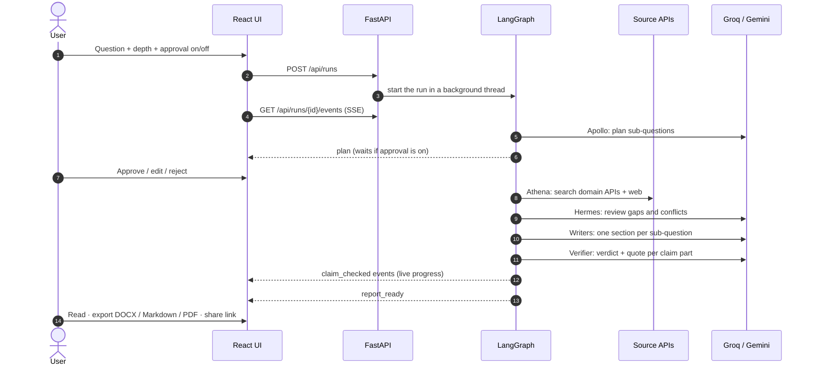
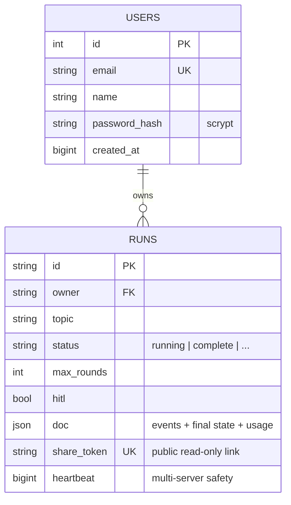

<div align="center">

# 🔎 Apollo

### An agentic AI research system that proves every line, and admits what it cannot prove.

Ask a question, paste a YouTube link or attach a PDF. Three autonomous AI agents plan, call research tools, review
their own coverage and loop back to fill gaps; every sentence of the report cites a source an agent actually read,
and **code** checks every claim against an exact quote from that source.

[](#-agentic-ai-design)
[](#-tech-stack)
[](#-tech-stack)
[](#-tech-stack)
[](#-tech-stack)
[](#-tech-stack)
[](#-tech-stack)
[](#-tech-stack)
[](#-tech-stack)
[](#-testing)

**[Live demo](https://apollo-innovista.onrender.com)** · **[Agentic design](#-agentic-ai-design)** · **[Architecture](#-architecture)** · **[How verification works](#-claim-verification-the-core-idea)** · **[Run it locally](#-run-it-locally)**

</div>

---

## 📌 At a glance

| | |
|---|---|
| **What** | A multi-agent AI system for deep research: question in, cited and fact-checked report out |
| **Agents** | **Apollo** plans and writes · **Athena** calls search tools and reads · **Hermes** reviews gaps and contradictions |
| **Orchestration** | A LangGraph state machine with a review-and-retry loop, human-approval interrupts and stop rules in code |
| **Core idea** | An LLM proposes a verdict and a quote; deterministic code accepts it only if the quote is really in the source |
| **Inputs** | A research question, a YouTube link (up to 35 minutes), or up to 3 attached documents (PDF, .txt, .md) |
| **Sources** | 6 research domains, each with a primary and a fallback API, plus a local cache |
| **Models** | A 9-model fallback chain across Groq and Gemini: a spent quota moves the call to the next model |
| **Stack** | LangGraph · Groq / Gemini LLMs · sentence-transformers · Python 3.11 · FastAPI, with a React UI for the live run |
| **Scale of the code** | ~6.6k lines of Python, ~5.5k lines of TypeScript/React, 237 automated tests |

---

## ❓ The problem

AI answers sound confident whether they are right or not. Chat assistants show links, but a reader cannot tell
whether the linked page actually says what the sentence claims, whether two sources disagree, or whether the model
simply filled a gap. Given a YouTube link, most assistants only see the title and description, and guess.

**Apollo treats every sentence of a report as a claim to be checked, and shows the reader the evidence for each one.**

## ✨ What makes it different

| Feature | What the user gets | How it is enforced |
|---|---|---|
| 🧾 **Claim-level verification** | Every claim is split into factual parts; each part is judged against an exact quote | The quote is checked **in code** against the source text. An invented quote can never verify a claim |
| 🚫 **Hallucination blocked by code** | Uncited sentences and citations to unknown sources never reach the report | `enforce_citations` runs on every model reply; stop rules and coverage targets are code, not prompts |
| ⚖️ **Contradictions shown, not hidden** | Sources that disagree are reported side by side; claims can be *contradicted* | Hermes compares sources pairwise; a quality check confirms no conflict was dropped |
| 🎥 **YouTube fact-check** | The video's spoken claims are checked against independent sources, each linked to the second it is said | Captions first, then a Gemini transcription; if neither works the run stops and says why, never guessing from the title |
| 🧑‍⚖️ **Human in the loop** | Approve, edit or reject the plan and the follow-up searches before they run | LangGraph `interrupt()` pauses the graph; Pause / Resume / Stop & Edit keep or restart the run |
| 🛟 **Never crashes a run** | A failed API, a busy model or an unreadable page becomes a warning, not an error page | Primary → fallback → cache for every source; a 9-model LLM chain; quota-aware cooldowns |

---

## 🧠 Agentic AI design

Apollo is not one prompt to one model. It is a set of agents with separate roles, tools and limits, coordinated by
a state machine. These are the agentic patterns it uses, and where each lives in the code:

| Pattern | How Apollo uses it | Where |
|---|---|---|
| **Multi-agent roles** | Apollo (planner / manager / writer), Athena (researcher), Hermes (critic): each has its own prompt, inputs and output schema | `graph/nodes.py` |
| **Planning** | The question is decomposed into 3-5 searchable sub-questions before any search runs | `apollo_plan` |
| **Tool use** | Athena calls real tools: web search, 6 domain APIs (papers, medicine, statistics, news, code), page and PDF readers, YouTube transcripts | `tools/` |
| **Tool routing** | Each query is classified by domain and sent to the right API, with a fallback API and a cache behind it | `tools/sources/router.py` |
| **Reflection loop** | Hermes critiques the gathered evidence, names gaps and contradictions, and orders follow-up searches; the graph loops back for a second round | `hermes_review`, `decide` |
| **Human in the loop** | LangGraph `interrupt()` pauses the graph so a person can approve, edit or reject the plan and the follow-up queries | `review_plan`, `review_gaps` |
| **Guardrails in code, not prompts** | Stop rules, coverage targets, citation enforcement and the exact-quote check are deterministic code around the model | `_stop_reason`, `enforce_citations`, `quote_in` |
| **Grounded generation** | Each section writer sees only the passages retrieved for its own sub-question; uncited sentences are removed; one writer per sub-question runs in parallel | `write_section` |
| **Self-verification** | A separate verifier model judges every claim part against quoted evidence, and code rejects invented quotes | `verify/claims.py` |
| **Model resilience** | A 9-model chain across two providers; a spent quota or a busy model hands the call to the next one | `core/llm.py` |
| **Observability** | Every agent step, tool call, token count and timing is streamed live and kept per run | `reports/events.py`, `core/metering.py` |

The web app (React) is the window onto this system: it shows each agent's state live, the approvals, and the
evidence behind every claim.

---

## 🏗 Architecture



One process serves the API and, in production, the built UI. Each research run executes in its own background
thread and streams typed events to the browser. A finished run is saved as one database row (events, final graph
state and usage meter), so every page can rebuild an old run after a restart or a redeploy.

---

## 🤖 The agent pipeline

```mermaid
stateDiagram-v2
    direction LR
    [*] --> Plan
    Plan: Apollo plans<br/>3-5 sub-questions
    Plan --> ApprovePlan
    ApprovePlan: Human approval<br/>(optional)
    ApprovePlan --> Search : approve / edit
    ApprovePlan --> [*] : reject
    Search: Athena searches<br/>domain APIs + web, reads pages
    Search --> Review
    Review: Hermes reviews<br/>coverage, gaps, contradictions
    Review --> ApproveGaps
    ApproveGaps: Human approval<br/>of follow-up queries (optional)
    ApproveGaps --> Decide
    Decide: Stop rules in code
    Decide --> Search : gaps left and round 2 allowed
    Decide --> Write : complete / round limit / time limit
    Write: Parallel section writers<br/>(sources of that section only)
    Write --> Verify
    Verify: Claim verification<br/>+ 9 quality checks
    Verify --> [*] : cited, verified report
```



**Stop rules (code, first match wins):** Hermes judges the sources sufficient *and* every sub-question has at least
two readable sources · the round limit is reached (max 2) · the research time limit (300 s) is used · the user
skipped the follow-up queries · no new queries are left.

---

## 🔍 Claim verification: the core idea



The model is never trusted on its own: it has to point at text, and code checks that the text exists. Verification
runs four claims at a time and publishes each result live, so the progress bar keeps moving.

> **Design note: grounded by design.** Verification confirms that every claim is faithfully supported by the
> source it cites. The reliability of the sources themselves is handled separately, through at least two sources
> per sub-question and source-vs-source contradiction checks.

---

## 🌐 Domain-aware source routing

Each search query is classified by keyword rules and sent to a specialist API on top of the web search.



If the primary API fails, the fallback answers; if both fail, a cached result (even a stale one) is used, and only
then does the domain return a graceful error. API keys are removed from every error message.

---

## 🔄 A research run, end to end



---

## 🗄 Data model



---

## 🧩 Features

<details open>
<summary><b>Research</b></summary>

- Three agents with up to **two research rounds**; Hermes orders follow-up searches for gaps.
- **Focused** (1 round) or **Deep** (2 rounds) depth.
- **Human in the loop**: approve, edit or reject the plan and the follow-up queries.
- **Pause / Resume** a running research; **Stop & Edit** changes the topic and restarts with the same settings.
- **YouTube links** (up to 35 min): the transcript becomes source S1, every passage linked to its timestamp.
- **Attached documents**: up to 3 PDFs or text files, cited and verified like web pages (with page numbers).

</details>

<details open>
<summary><b>Trust and quality</b></summary>

- Per-claim verdicts: `verified`, `partial`, `contradicted`, `not_found`, `unchecked`.
- **Evidence Explorer**: claim → parts → highlighted passage → source.
- **Claim-evidence graph**: which sources each claim rests on.
- Nine quality checks before completion (sources per question, citations, exact quotes, contradictions, duplicates…).
- Duplicate and off-topic pages are dropped; "Not found in sources" is written instead of guessing.

</details>

<details open>
<summary><b>Web app</b> (11 pages)</summary>

| Page | What it shows |
|---|---|
| Dashboard | Start a run, live intelligence for the selected run, recent sessions |
| New Research / Live Report | The report as it is written: stage rail, agent cards, event log, approvals |
| Analytics | Sessions over time, completion rate, verified-claim trend |
| Claims & Evidence | Every checked claim with its evidence chain and graph |
| Evidence Explorer | Claim parts with highlighted source passages |
| Contradictions | Conflicting sources side by side, plus a conflict map |
| Source Intelligence | Each source's type, use in citations and claim outcomes |
| Cost & Execution | LLM calls, tokens per model and agent, searches, time per stage |
| Verification | Quality checks, citation accuracy, support per section |
| Final Reports | **DOCX**, Markdown and PDF export; **public read-only share link** (can be turned off) |

Plus: account login with private runs, a **light/dark theme**, a mini-game while research runs, and a
phone-friendly responsive layout.

</details>

<details open>
<summary><b>Engineering details worth noting</b></summary>

- **Resilience:** 9-model LLM fallback chain with quota cooldowns; primary → fallback → cache for every source.
- **Live UI:** Server-Sent Events with heartbeats and automatic reconnect; progress derived from real events.
- **Multi-server safe:** run heartbeats let two servers (e.g. a laptop and the cloud) share one database
  without marking each other's live runs as interrupted.
- **Security:** scrypt password hashes, HttpOnly SameSite JWT cookie, per-user run isolation, 256-bit share tokens,
  API keys only in environment variables and redacted from errors.
- **Free-tier deploy:** a separate Docker image runs the same embedding model through ONNX (no PyTorch) to fit
  512 MB of RAM on Render.
- **Offline replay mode:** `LLM_MODE=replay` runs the whole pipeline with fixed fixtures: no keys, no network,
  no quota. Used for demos and offline testing.

</details>

---

## 🛠 Tech stack

| Layer | Technology |
|---|---|
| **Agent orchestration** | LangGraph (StateGraph, checkpointer, interrupts) |
| **LLMs** | Groq (gpt-oss-120b, gpt-oss-20b, …) · Google Gemini (3.x flash-lite, …) |
| **Embeddings / retrieval** | all-MiniLM-L6-v2 via sentence-transformers (local) or ONNX/fastembed (cloud) |
| **Agent tools (research sources)** | Tavily · Serper · OpenAlex · Crossref · PubMed · Europe PMC · World Bank · IMF · Guardian · GitHub · Stack Exchange |
| **Backend** | Python 3.11 · FastAPI · Uvicorn · Server-Sent Events |
| **Frontend** | React 18 · TypeScript (strict) · Vite 8 · Tailwind CSS 4 · react-markdown |
| **Content extraction** | trafilatura (web) · pypdf (PDF) · youtube-transcript-api + Gemini (video) |
| **Exports** | python-docx (Word) · Markdown · browser print (PDF) |
| **Data** | SQLAlchemy Core · Neon Postgres (cloud) · SQLite (local) |
| **Auth** | scrypt · PyJWT (HS256) |
| **Deploy / test** | Docker · Render · pytest |

---

## 📁 Project structure

```text
.
├── backend/
│   ├── api.py               FastAPI app: auth, runs, SSE, reports, exports, share links
│   ├── graph/               LangGraph workflow and the agent nodes (Apollo, Athena, Hermes)
│   ├── verify/claims.py     claim verification: passages, LLM verdicts, quote check in code
│   ├── tools/               search, source router + adapters, extraction, video, documents, quality checks
│   ├── reports/             Markdown / DOCX export, events, contradiction map
│   ├── core/                config, LLM fallback chain, auth, database, replay mode
│   └── tests/               237 pytest tests (offline: fakes and replay fixtures)
├── frontend/
│   └── src/                 React app: pages/, components/, store, SSE hook, theme
├── Dockerfile               full image (PyTorch embeddings)
├── Dockerfile.render        512 MB image (ONNX embeddings) for Render's free tier
├── requirements.txt         every Python package to run locally
└── .env.example             all settings and the API keys to fill in
```

---

## 🚀 Run it locally

**Prerequisites:** Python 3.11, Node.js 22, Git, and free API keys for
[Tavily](https://tavily.com), [Groq](https://console.groq.com) and [Gemini](https://aistudio.google.com)
(Serper and the domain keys are optional).

```bash
git clone https://github.com/S-2007/Apollo-Research.git
cd Apollo-Research
```

**1. Python packages**

```bash
py -3.11 -m venv .venv
.venv\Scripts\python -m pip install -r requirements.txt
```

macOS / Linux: `python3.11 -m venv .venv` and `.venv/bin/python -m pip install -r requirements.txt`.

**2. Keys:** copy `.env.example` to `.env` and fill in at least `TAVILY_API_KEY`, `GROQ_API_KEY`, `GEMINI_API_KEY`
and `JWT_SECRET` (any long random string). Leave `DATABASE_URL` empty to use a local SQLite file.
**Never commit `.env`.**

**3. Frontend packages**

```bash
cd frontend
npm ci
cd ..
```

**4. Start** (two terminals, from the project folder)

```bash
.venv\Scripts\python -m uvicorn api:app --app-dir backend --port 8000
```

```bash
cd frontend
npm run dev
```

Open **http://localhost:5173**, create an account and start a research run. The first run downloads the embedding
model (~90 MB) once.

> **No keys?** Set `LLM_MODE=replay` in `.env` to run the whole pipeline offline with fixed demo data.

---

## 🧪 Testing

```bash
.venv\Scripts\python -m pytest -q
```

**237 tests**, all offline (fake search and LLMs, or replay fixtures), covering:

- the agent graph and its stop rules, human approval, pause / resume / stop & restart;
- claim verification and the exact-quote check (including special dashes and invented quotes);
- source routing, fallbacks, cache and key redaction;
- YouTube reading, the 35-minute limit and Gemini fallbacks;
- authentication, per-user isolation, public share links and DOCX export;
- the database layer, quota handling and the LLM fallback chain.

---

## ☁️ Deployment

| Target | Image | Notes |
|---|---|---|
| **Render** (free, 512 MB) | `Dockerfile.render` | ONNX embeddings, keyword passage ranking, page text from the search provider first |
| **Any Docker host / Hugging Face Spaces** | `Dockerfile` | Full PyTorch embeddings, port 7860 |

Keys and `DATABASE_URL` come from the host's environment variables, never from the image. Step-by-step instructions
are in [`docs/DEPLOY.md`](docs/DEPLOY.md).

---

## ⚠️ Known limits

- **Verification is source-grounded:** it confirms that every claim is faithfully supported by the source it cites.
  The reliability of the sources themselves is handled separately, through at least two sources per sub-question
  and source-vs-source contradiction checks.
- YouTube videos longer than 35 minutes are refused; cloud servers usually cannot fetch captions, so Gemini
  transcribes the video instead.
- Free model and search quotas limit how many runs can be done per day.

## 🗺 Roadmap

- Source credibility signals beyond the domain heuristic.
- Longer videos by transcribing in parts.
- Team workspaces with shared, commentable reports.

---

<div align="center">

**Built by** Sarthak Bhatt · [LinkedIn](https://www.linkedin.com/in/sarthak-bhatt-9b3767320) · [GitHub](https://github.com/S-2007)

<sub>Team: Nirmay Tripathi, Tushar Tiwari</sub>

</div>
