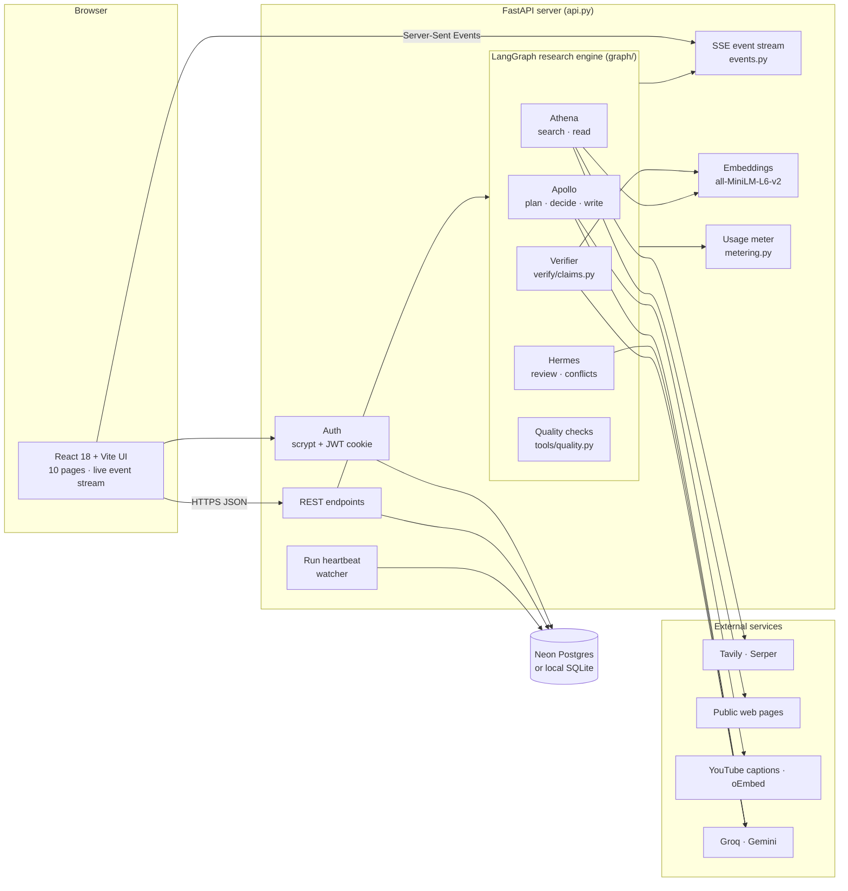
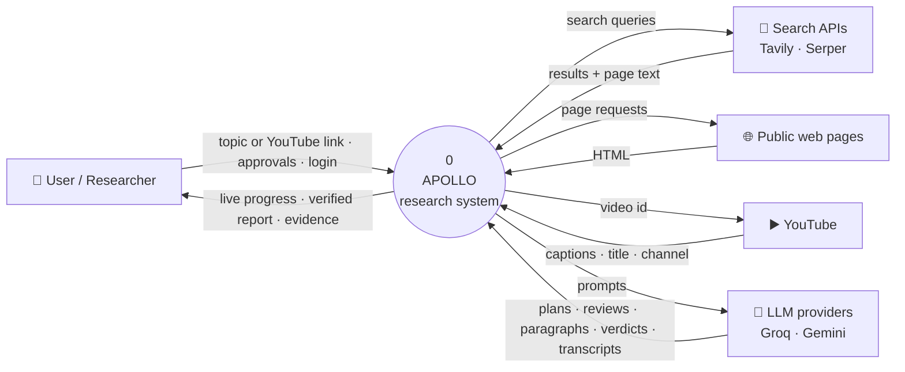
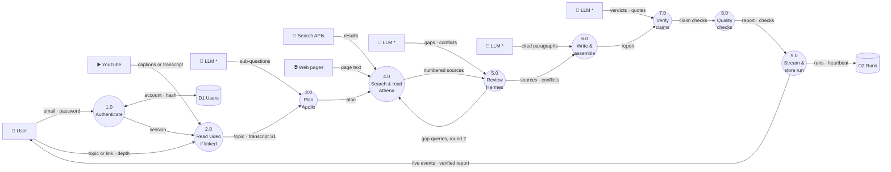
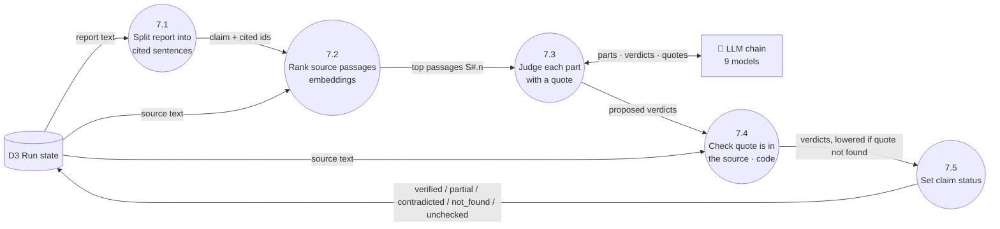
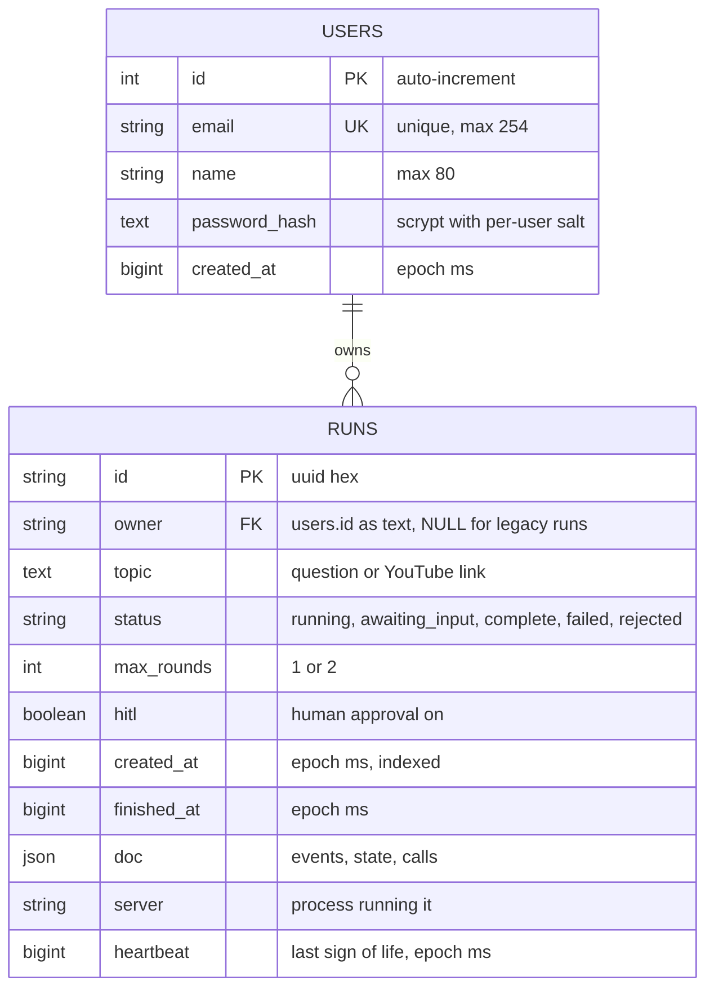
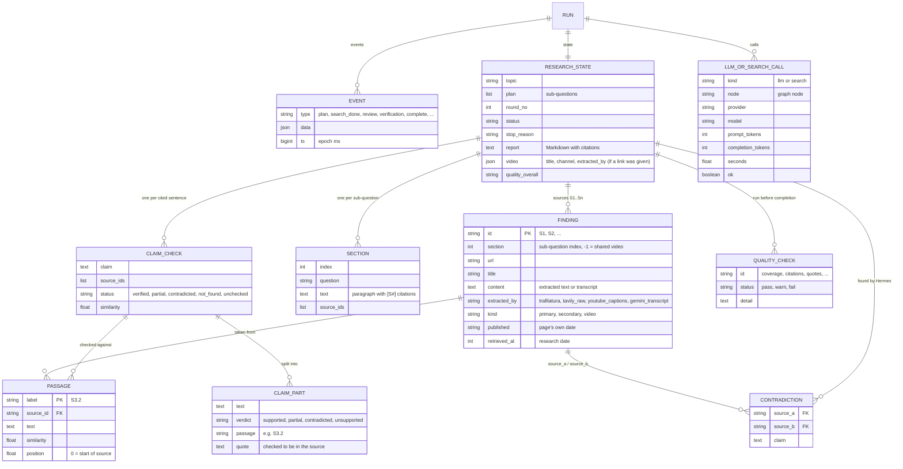
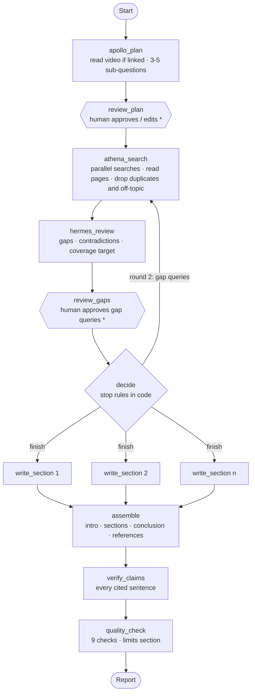
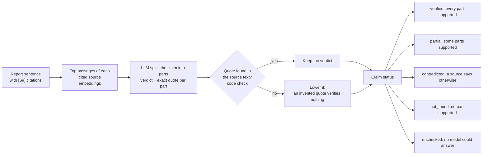
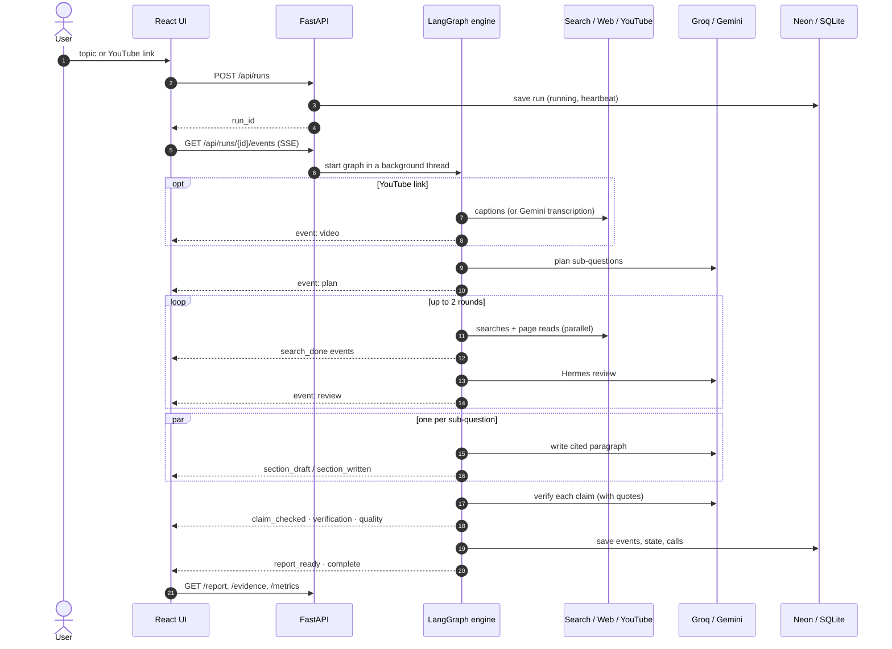

<div align="center">

# Apollo · Multi-Agent Deep Research

**Research that proves every line, and admits what it cannot prove.**

Give Apollo a question, or a YouTube link, and get back a report in which every sentence cites a source Apollo
actually read. Code then checks every claim against an exact quote from that source.


</div>

---

## Contents

1. [The problem](#1-the-problem)
2. [What makes Apollo different](#2-what-makes-apollo-different)
3. [Features](#3-features)
4. [System architecture](#4-system-architecture)
5. [Data flow diagrams](#5-data-flow-diagrams-dfd)
6. [Entity relationship diagram](#6-entity-relationship-diagram)
7. [The agent pipeline](#7-the-agent-pipeline)
8. [Claim verification](#8-claim-verification)
9. [Sequence of a research run](#9-sequence-of-a-research-run)
10. [Tech stack](#10-tech-stack)
11. [Project structure](#11-project-structure)
12. [Installation](#12-installation)
13. [Configuration](#13-configuration)
14. [Usage](#14-usage)
15. [API reference](#15-api-reference)
16. [Testing and evaluation](#16-testing-and-evaluation)
17. [Deployment](#17-deployment)
18. [Known limits](#18-known-limits)
19. [Roadmap](#19-roadmap)

---

## 1. The problem

AI answers sound confident whether they are right or not. Chat assistants cite links, but a reader cannot tell
whether the linked page actually says what the sentence claims, whether two sources disagree, or whether the
model simply filled a gap. Given a YouTube link, most assistants only see the title and description, so they
guess the video's content.

Apollo treats every sentence of a report as a claim to be checked, and shows the reader the evidence for each one.

## 2. What makes Apollo different

| | What it means | How it is enforced |
|---|---|---|
| **Claim-level verification** | Each sentence is split into its factual parts, and each part is judged against an exact quote from a cited source | The LLM proposes a verdict and a quote; **code** (`quote_in`) checks the quote really is in the source text, so an invented quote cannot verify anything |
| **Hallucination blocked by code** | Writers see only their section's sources; uncited sentences and citations to unknown sources never reach the report | `enforce_citations` runs on every model reply; stop rules, coverage targets and quality checks are code, not prompts |
| **Contradictions shown, not hidden** | Disagreeing sources are reported side by side; claims can be *contradicted* | Hermes finds conflicts per source pair; the writer must cite both sides; a quality check confirms none was dropped |
| **YouTube fact-check with timestamps** | Paste a video link: Apollo reads the spoken words, checks the video's claims against independent sources, and links each passage to the second it is said | Captions first, then a Gemini transcription; if neither works the run stops with the reason and never guesses from the title |

## 3. Features

<details open>
<summary><b>Research</b></summary>

- **Three agents**: Apollo (planner and manager), Athena (search and reading), Hermes (reviewer).
- **Up to two research rounds**: Hermes finds gaps and orders follow-up searches.
- **Human in the loop** (optional): approve or edit the plan and the follow-up queries before they run.
- **Parallel section writers**, one per sub-question.
- **YouTube links**: the transcript becomes source S1 for every section.
- **Attached documents**: up to 3 PDFs, .txt or .md files per run become sources for every section, cited
  and verified like web pages, with page numbers for PDFs.

</details>

<details open>
<summary><b>Trust and verification</b></summary>

- Per-claim verdicts: `verified`, `partial`, `contradicted`, `not_found`, `unchecked`.
- Exact-quote check in code, with highlighted passages and their context in the **Evidence Explorer**.
- An honest "Not found in sources." when the sources do not answer a point.
- Contradiction detection, plus an interactive conflict map.

</details>

<details open>
<summary><b>Research-quality rules</b> (<code>tools/quality.py</code>)</summary>

- Minimum readable sources per sub-question, with automatic follow-up searches.
- Original research and official publications are read and listed first. This is a rule from the web address, not a credibility score.
- Duplicate articles (word 5-gram overlap) and off-topic pages (key-word share) are dropped.
- The publication date is kept apart from the research date.
- Nine quality checks run before completion, and the report ends with an "Evidence limits and quality checks" section.

</details>

<details open>
<summary><b>Reliability</b></summary>

- **LLM fallback chains**: 9 models across Groq and Gemini. A spent quota or a busy model hands the call to the next one.
- If every model is out of quota, the run stops *before* searching, with a clear message.
- Citation formats models invent (`【S6】`, `[S6†L1-L4]`, `(S6)`, `[S1-S3]`) are normalised instead of dropped.
- **Run heartbeats**: several servers can share one database without marking each other's live runs as interrupted.
- Failures never crash a run. A failed search or an unreadable page becomes a warning in the UI.

</details>

<details open>
<summary><b>Web app</b> (React, 10 pages)</summary>

| Page | What it shows |
|---|---|
| Dashboard | Start a run, recent sessions, totals |
| New Research | Topic form, depth, approval toggle, YouTube detection, document upload |
| Live Report | The report as it is written: stage rail, active agents, event log |
| Analytics | Sessions over time, completion rate, verified-claim trend |
| Claims & Evidence | Every checked claim with its evidence chain |
| Evidence Explorer | Claim → parts → highlighted passage → source (with video timestamps) |
| Contradictions | Conflicting sources side by side, plus the conflict map |
| Source Intelligence | Each source's type, dates, citation use and claim outcomes |
| Cost & Execution | LLM calls, tokens per model and per agent, searches, time per stage |
| Verification | Quality checks, citation accuracy, support per section |
| Final Reports | Markdown and PDF export, shareable link |

</details>

## 4. System architecture



One process serves the API and, in production, the built UI. Each run executes in its own background thread and
streams typed events to the browser. A finished run is stored as a single row: its events, its final graph state
and its usage-meter calls. Everything a page shows for an old run is rebuilt from that row.

## 5. Data flow diagrams (DFD)

### Level 0: context diagram



### Level 1: main processes

Data moves left to right through nine processes. `*` marks an external entity drawn more than once, so the
diagram stays readable.



With human approval switched on, process 3.0 sends the plan to the user and waits for approval or an edit, and
process 5.0 does the same with its gap queries.

### Level 2: process 7.0, claim verification



## 6. Entity relationship diagram

Two tables hold everything. A run's research data lives in one JSON document (`runs.doc`, JSONB on Postgres),
because a run is always written and read as a whole. The second diagram shows that document's logical structure.

### Physical schema



`owner` stores `users.id` as text. The relationship is enforced by the API (each user sees only their own runs),
not by a database constraint.

### Logical model of a run document (`runs.doc`)



## 7. The agent pipeline

The research engine is a LangGraph `StateGraph` (`graph/workflow.py`). Each node is one agent step; every node
catches its own failures, so the graph always reaches the end.



`*` pauses only when human approval is switched on.

**Stop rules, in code** (`decide`, first match wins): Hermes judged the sources complete and the coverage target
is met; 2 rounds done; the 300 s research time limit reached; you skipped the gap queries; no new follow-up queries.

| Agent | Node(s) | Job |
|---|---|---|
| **Apollo** (manager) | `apollo_plan`, `decide`, `write_section`, `assemble` | Plans sub-questions (from the video's claims when a link is given), applies stop rules, writes cited paragraphs |
| **Athena** (searcher) | `athena_search` | Runs every query in parallel (Tavily, Serper fallback), puts original research first, extracts text, numbers sources |
| **Hermes** (reviewer) | `hermes_review` | Judges coverage from the most relevant passages, proposes gap queries, reports source-vs-source conflicts |
| **Verifier** | `verify_claims` | Checks each cited sentence against its sources (section 8) |

## 8. Claim verification



The verifier walks its own model chain. A spent daily quota removes that model for the rest of the report; any
other failure (a per-minute limit, an overloaded model) moves only that claim to the next model.

## 9. Sequence of a research run



## 10. Tech stack

| Layer | Technology |
|---|---|
| Agent orchestration | LangGraph 1.2 (`StateGraph`, `Send` fan-out, `interrupt` for human approval) |
| Backend | FastAPI 0.162, Uvicorn, Server-Sent Events, Pydantic |
| LLMs | Groq (`openai/gpt-oss-120b`, `gpt-oss-20b`, `qwen/qwen3.8-27b`), Google Gemini (flash / flash-lite / gemma) |
| Search and reading | Tavily (primary), Serper (fallback), trafilatura, YouTube captions (`youtube-transcript-api`) |
| Embeddings | `sentence-transformers/all-MiniLM-L6-v2` (PyTorch locally, ONNX on small servers) |
| Data | SQLAlchemy Core 2.0 on Neon Postgres (psycopg 3) or SQLite |
| Auth | scrypt password hashes, JWT (PyJWT) in an HttpOnly, SameSite=strict cookie |
| Frontend | React 18, Vite, TypeScript (strict), Tailwind CSS 4, react-markdown |
| Reliability | tenacity retries, model fallback chains, run heartbeats |
| Tests | pytest, fully offline with fakes (173 tests) |
| Deployment | Docker (Hugging Face Spaces, Render), or an Oracle Cloud VM with Caddy |

## 11. Project structure

The repository is split by who runs the code: `backend/` (Python API and agents), `frontend/` (React app) and
`docs/`. Inside `backend/`, each package has one job.

```
Apollo-Innovista/
├── backend/                     Python 3.11: API, agents, verification
│   ├── api.py                   FastAPI app (entry point): auth, runs, SSE, reports, evidence, metrics, heartbeats
│   ├── run_cli.py               command-line runner
│   ├── core/                    shared foundation, used by every other package
│   │   ├── config.py            every setting, read from .env with safe defaults
│   │   ├── db.py                SQLAlchemy tables (users, runs) and automatic column migration
│   │   ├── auth.py              accounts: scrypt hashing, JWT sessions, login rate limiting
│   │   ├── llm.py               LLM client: fallback chain, quota cooldown, video transcription
│   │   ├── metering.py          per-run usage meter (LLM calls, tokens, searches, time)
│   │   └── live.py              live events from inside the agents (drafts, claim progress)
│   ├── graph/                   the agents (LangGraph)
│   │   ├── state.py             ResearchState and every record type
│   │   ├── nodes.py             plan, search, review, decide, write, assemble, verify, quality
│   │   └── workflow.py          the StateGraph and its edges
│   ├── tools/                   what the agents use
│   │   ├── search.py            Tavily / Serper with retries
│   │   ├── extract.py           page text and publication dates
│   │   ├── video.py             YouTube: link detection, captions, Gemini fallback, timestamps
│   │   ├── documents.py         attached PDFs and text files, with page markers
│   │   ├── passages.py          most relevant passages for a question
│   │   ├── embed.py             embedding model (torch or ONNX), batching, cache
│   │   ├── quality.py           research-quality rules and checks
│   │   ├── text.py              citations, sentence splitting, normalisation
│   │   ├── jsonparse.py         tolerant JSON parsing of model replies
│   │   └── retry_policy.py      which errors are retried, which mean "quota spent"
│   ├── verify/claims.py         claim verification
│   ├── reports/                 what a run produces for people
│   │   ├── events.py            graph updates -> typed UI events
│   │   ├── export.py            Markdown report export
│   │   └── contradictions.py    interactive conflict map (pyvis)
│   ├── scripts/                 eval_verifier, check_citations, claim_runs, migrate_to_db
│   ├── tests/                   173 offline tests
│   ├── requirements.txt         full install (PyTorch embeddings)
│   └── requirements-render.txt  small servers (ONNX embeddings, no PyTorch)
├── frontend/                    React 18 + Vite + TypeScript + Tailwind 4
│   └── src/
│       ├── pages/               the 10 pages and the live report
│       ├── components/          agent strip, event log, topic form, approval panel, report view
│       ├── api.ts               typed API client and event types
│       ├── derive.ts            event list -> everything the UI shows
│       └── index.css            design tokens and motion system
├── docs/
│   ├── DEPLOY.md                step-by-step deployment
│   ├── DEMO.md                  demo script
│   ├── demo-topics.md           demo topics served by /api/demo-topics
│   └── PHASE_LOG.md             what was built and verified in each phase
├── Dockerfile                   single container (Hugging Face Spaces, port 7860)
├── Dockerfile.render            Render free tier (512 MB, ONNX embeddings)
├── pytest.ini                   runs backend/tests from the repository root
├── .env.example                 every setting, with placeholders
└── README.md
```

Local data (never committed): `.env` and `output/` (SQLite database, report exports) at the repository root.

## 12. Installation

### Prerequisites

| Tool | Version |
|---|---|
| Python | 3.11 |
| Node.js | 22 (the version the Dockerfile builds with) |
| Git | any recent version |
| API keys | **Tavily** and **Groq** required; **Gemini** strongly recommended (fallback models, YouTube without captions); Serper optional |

Free keys: [Tavily](https://tavily.com), [Groq](https://console.groq.com), [Google AI Studio](https://aistudio.google.com) for Gemini, [Serper](https://serper.dev).

### Step 1: clone

```bash
git clone https://github.com/S-2007/Apollo-Innovista.git
cd Apollo-Innovista
```

### Step 2: Python environment

Windows (PowerShell):

```powershell
py -3.11 -m venv .venv
.venv\Scripts\python -m pip install -r requirements.txt
```

macOS / Linux:

```bash
python3.11 -m venv .venv
.venv/bin/python -m pip install -r requirements.txt
```

### Step 3: keys and settings

```bash
cp .env.example .env
```

Fill in at least `TAVILY_API_KEY`, `GROQ_API_KEY` and `JWT_SECRET`. Create the secret with:

```bash
python -c "import secrets; print(secrets.token_urlsafe(48))"
```

Leave `DATABASE_URL` empty to use a local SQLite file (`output/apollo.db`), or set a Neon connection string. **Never
commit `.env`.**

### Step 4: frontend packages

```bash
cd frontend
npm ci
cd ..
```

### Step 5: run

Terminal 1, backend (from the repository root):

```bash
.venv/Scripts/python -m uvicorn api:app --app-dir backend --port 8000      # Windows
.venv/bin/python -m uvicorn api:app --app-dir backend --port 8000          # macOS / Linux
```

Terminal 2, frontend:

```bash
cd frontend
npm run dev
```

Open **http://localhost:5173**, create an account and start a run. The first run downloads the embedding model
(about 90 MB) once.

### Option: one Docker container

```bash
docker build -t apollo .
docker run -p 7860:7860 --env-file .env apollo
```

Open **http://localhost:7860**. The image builds the UI and serves it from FastAPI on the same origin.

## 13. Configuration

All settings live in `.env` at the repository root and have safe defaults (`backend/core/config.py`).

<details open>
<summary><b>Keys and models</b></summary>

| Variable | Default | Purpose |
|---|---|---|
| `TAVILY_API_KEY` | | Web search (required) |
| `SERPER_API_KEY` | | Search fallback (optional) |
| `GROQ_API_KEY` | | Groq models (required) |
| `GEMINI_API_KEY` | | Gemini models; YouTube transcription fallback |
| `LLM_PROVIDER` | `groq` | Which provider's models come first |
| `GROQ_MODEL` | `openai/gpt-oss-120b` | Main Groq model |
| `GEMINI_MODEL` | `gemini-3.1-flash-lite` | Main Gemini model |
| `GEMINI_FALLBACK_MODEL` | `gemini-flash-lite-latest` | Second Gemini model |
| `VERIFY_MODEL` | `openai/gpt-oss-20b` | First model for claim verification |
| `GROQ_SPARE_MODELS` | `qwen/qwen3.8-27b` | Extra Groq models, used after the main ones |
| `GEMINI_SPARE_MODELS` | `gemini-3-flash-preview,gemini-3.6-flash,gemini-3.5-flash,gemma-4-26b-a4b-it` | Extra Gemini models |
| `LLM_CHAIN`, `VERIFY_CHAIN` | built from the above | Override a whole chain: `provider:model,provider:model,...` |
| `LLM_COOLDOWN_SECONDS` | `600` | How long a model with a spent quota is skipped |

</details>

<details>
<summary><b>Research loop and reading</b></summary>

| Variable | Default | Purpose |
|---|---|---|
| `MAX_ROUNDS` | `2` | Research rounds (the API caps this at 2) |
| `TIMEOUT_SECONDS` | `300` | Research time budget per run: after it no new search round starts; writing and verification still run |
| `REQUEST_TIMEOUT_SECONDS` | `15` | Per HTTP request |
| `SEARCH_MAX_RETRIES`, `LLM_MAX_RETRIES` | `2` | Retries on transient errors |
| `SEARCH_WORKERS` | `5` | Searches at once |
| `EXTRACT_WORKERS` | `6` | Pages read at once |
| `EXTRACT_ORDER` | `own` | `own` (download + trafilatura first) or `provider_first` (search provider's text first; faster on small servers) |
| `MAX_PAGE_BYTES` | `3000000` | Stop downloading a page after this size |
| `MIN_SOURCES_PER_QUESTION` | `2` | Coverage target per sub-question |
| `FETCH_PUBLISH_DATES` | `true` | Read each page's publication date |
| `VIDEO_GEMINI_FALLBACK` | `true` | Let Gemini transcribe a video without usable captions |
| `VIDEO_GEMINI_MODEL` | `GEMINI_MODEL` | Model used for transcription |
| `VIDEO_TIMEOUT_SECONDS` | `180` | Transcription time limit |
| `DOCUMENT_MAX_BYTES` | `10000000` | Largest attached file (3 files per run; 40,000 characters of text kept from each) |

</details>

<details>
<summary><b>Verification, embeddings, accounts, storage</b></summary>

| Variable | Default | Purpose |
|---|---|---|
| `VERIFY_WORKERS` | `4` | Claims checked at once |
| `VERIFY_MAX_SENTENCES` | `0` | Compare only the N best keyword matches per source (`0` = all) |
| `PASSAGE_RANKING` | `embedding` | `embedding` or `keyword` (no embedding before review; for slow hosts) |
| `EMBED_BACKEND` | `torch` | `torch` or `onnx` (lighter, for 512 MB servers) |
| `EMBED_WARM_UP` | `false` | Load the embedding model when a run starts |
| `JWT_SECRET` | | Signs session tokens (required for the web app) |
| `JWT_TTL_HOURS` | `12` | Session length |
| `COOKIE_SECURE` | `false` | Set `true` behind HTTPS |
| `DATABASE_URL` | | Postgres URL (Neon); empty = SQLite |
| `OUTPUT_DIR` | `output` | Local files (SQLite database, report exports) |
| `PRICE_<PROVIDER>_INPUT_PER_M` / `_OUTPUT_PER_M` | | Optional: show an estimated cost in USD |

</details>

## 14. Usage

**Web app**

1. **New Research**: type a question, or paste a YouTube link (optionally followed by a question). Use
   **Attach document** to add up to 3 PDFs, .txt or .md files; each shows how many pages were read, or why not.
2. Choose **Focused** (1 round) or **Deep** (2 rounds), and optionally switch on **human approval**.
3. Watch the **Live Report**: agents, stages, sources and paragraphs appear as they happen.
4. Open the **Evidence Explorer**: pick a claim to see its parts, the quoted passages and the source, or for a
   video, the moment it is said.
5. Export from **Final Reports** (Markdown, or PDF via the browser's print dialog) or copy a share link.

**Command line**

```bash
.venv/Scripts/python backend/run_cli.py "Does remote work increase productivity?"
.venv/Scripts/python backend/run_cli.py "https://youtu.be/VIDEO_ID is this accurate?" --max-rounds 1
.venv/Scripts/python backend/run_cli.py "your topic" --hitl          # approve the plan and gap queries in the terminal
```

Options: `--max-rounds`, `--timeout`, `--hitl`, `--no-gap-review`, `--out-dir`, `--doc FILE` (attach a document; repeat up to 3 times).

## 15. API reference

Every endpoint except `/api/auth/*` needs the session cookie.

| Method | Path | Purpose |
|---|---|---|
| POST | `/api/auth/register` | Create an account, start a session |
| POST | `/api/auth/login` | Sign in |
| POST | `/api/auth/logout` | Sign out |
| GET | `/api/auth/me` | Current user |
| POST | `/api/documents` | Upload one file (multipart `file`: PDF, .txt, .md). Read at once; returns its id, pages and characters, or 422 with the reason (for example a scanned PDF with no text) |
| POST | `/api/runs` | Start a run: `{topic, max_rounds, hitl, documents}` (`documents`: up to 3 ids from `/api/documents`). Returns 503 when every model is out of quota |
| GET | `/api/runs` | Your runs, newest first |
| GET | `/api/runs/{id}` | Status of one run |
| GET | `/api/runs/{id}/events` | Live event stream (SSE) |
| POST | `/api/runs/{id}/resume` | Answer an approval: `approve`, `edit`, `reject`, `skip` |
| GET | `/api/runs/{id}/report` | Report, sources, claims, sections, quality checks, video |
| GET | `/api/runs/{id}/evidence` | Claims with parts and passages (video passages carry `start` seconds) |
| GET | `/api/runs/{id}/report.md` | Markdown download |
| GET | `/api/runs/{id}/contradictions` | Interactive conflict map (HTML) |
| GET | `/api/runs/{id}/metrics` | LLM calls, tokens, searches, time per stage |
| GET | `/api/system` | Which keys are set (never their values), database kind |
| GET | `/api/demo-topics` | Demo topics |
| POST | `/api/cache/clear` | Start a demo clean: drops cached embeddings **and deletes your finished runs** |

**Live events** (`/events`, in order of a run): `video` · `plan` · `search_started` · `search_results` ·
`search_done` / `search_failed` · `review` · `gaps_pending` · `section_draft` · `section_written` ·
`report_written` · `claim_checked` · `verification` · `quality` · `contradictions` · `report_ready` ·
`warning` · `error` · `complete`. `error` and `complete` end the stream; `warning` never does.

## 16. Testing and evaluation

```bash
.venv/Scripts/python -m pytest -q          # from the repository root (pytest.ini points at backend/tests)
```

All 173 tests run **offline**: search, pages, LLMs, embeddings and YouTube are fakes, and `conftest.py` blanks every
API key, so a test can never spend quota.

| Area | File |
|---|---|
| Research loop, stop rules, approval pauses | `test_phase1.py` |
| Citations, references, verification, export | `test_phase2.py` |
| API, events, reports, evidence, metrics | `test_phase3_api.py` |
| Research-quality rules | `test_quality.py` |
| YouTube reading, fallbacks, timestamps | `test_video.py` |
| Attached documents: PDF and text reading, uploads, page numbers | `test_documents.py` |
| Quota handling and model fallback | `test_quota.py`, `test_llm_chain.py`, `test_verify_parallel.py` |
| Accounts, database, heartbeats, migration | `test_auth.py`, `test_database.py` |
| Embedding backends | `test_embed_backend.py` |

**Verifier evaluation:** `backend/scripts/eval_verifier.py` compares the verifier with hand-labelled claims. On 37 labelled
claims it agreed on 36. This figure is **optimistic**: the verifier was tuned on the same set, so a held-out test
set is still needed.

**Citation check:** `backend/scripts/check_citations.py <run output folder>` reads that folder's `report.md` and
`findings.json`, and fails unless every cited `[S#]` is a real source with a URL, every cited id is in References,
and References lists nothing uncited.

## 17. Deployment

[docs/DEPLOY.md](docs/DEPLOY.md) has step-by-step guides:

- **Render** (free, no card): `Dockerfile.render`, tuned for 512 MB (ONNX embeddings, provider text first).
- **Oracle Cloud VM** (always on): Docker plus Caddy for HTTPS.
- **Hugging Face Spaces**: `Dockerfile` (port 7860).
- **Neon** Postgres for accounts and saved runs.

Every server that shares one database should run the same version, so that run heartbeats protect each other's live
runs.

## 18. Known limits

- **Free-tier quotas.** A run uses roughly 30–60k tokens. The 9-model chain stretches the free quotas, but heavy
  use in one day can still exhaust them; Apollo then says so instead of returning an empty report.
- **"Verified" means the source says it**, not that it is true. Each verdict shows its quote, so a person can check.
- **Hermes is one LLM judgement over excerpts.** It can miss a contradiction or report a scope difference as one.
- **"Original research" is a rule from the web address**, not a credibility score.
- **PDFs found by web search are skipped**; only PDFs you attach are read. Scanned PDFs (images without a text
  layer) are refused, because Apollo does not run OCR. Word files are not supported yet.
- **YouTube:** transcripts are capped at about 45 minutes (the report says when a video was cut), and a Gemini
  transcription is model output, not the video's own captions.
- **Speed:** a run takes about 2–4 minutes.

## 19. Roadmap

- Reading PDFs found by web search, and Word (.docx) attachments.
- A held-out evaluation set for the verifier, scored by people who have not seen Apollo's verdicts.
- An agent that searches specifically for evidence *against* each claim.
- Images as sources.

---

<div align="center">

[S-2007/Apollo-Innovista](https://github.com/S-2007/Apollo-Innovista) · build history and verification notes in [docs/PHASE_LOG.md](docs/PHASE_LOG.md)

</div>
